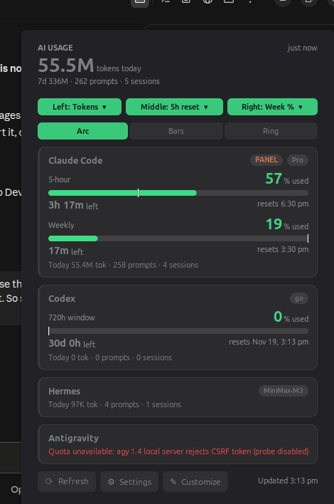

# AI Usage Meter for Cinnamon

A Cinnamon panel applet that shows Claude Code, Codex, Hermes and Antigravity usage: tokens today, 5-hour and weekly limits, reset countdowns and pace. Inspired by the agent usage panel in [Omarchy](https://github.com/omacom/omarchy).




[CodexBar](https://github.com/steipete/CodexBar) covers macOS and has a Linux Qt app, and Waybar and GNOME scripts exist. We found no native Cinnamon applet in a GitHub search (Oct 2026).

## Views

| View | Meaning |
|---|---|
| Tokens | Tokens used today across all tools |
| 5h reset | Countdown to the 5-hour limit reset |
| 5h % | 5-hour limit used |
| Pace | Projected 5-hour usage at reset at the current rate (used / fraction of window elapsed). Shown after 30 minutes. |
| Week % | Weekly limit used |
| Wk reset | Countdown to the weekly limit reset |

## Panel

- Three slots: left, middle, right. Each shows one view.
- Three designs: Arc, Bars, Ring.
- Colors: green below 65%, orange 65-89%, red 90% and above. Red values are underlined with a faint red glow.
- The white tick on bars and arc marks the even-pace point: how far through the window you are.
- Values dim when data is older than 15 minutes and show `--` after 60 minutes.

## Use

- Left-click or scroll: next view in the middle slot.
- Right-click: details popup. In panel edit mode, right-click shows Cinnamon's normal menu.
- Popup top: the Left, Middle and Right buttons open a dropdown to choose each slot. The Arc, Bars and Ring buttons switch design.
- Popup footer: Refresh, Settings, Customize.
- Customize: auto-shuffle the middle view, shuffle designs, set each provider to Shown or Hidden, and pick which provider drives the panel.

## Supported tools

| Tool | Limits | Tokens today |
|---|---|---|
| Claude Code | 5-hour and weekly, via your existing login | from `~/.claude/projects` logs |
| Codex CLI | plan window | from `~/.codex` logs |
| Hermes | none (provider exposes no limits) | from `~/.hermes/state.db` (read-only) |
| Antigravity (`agy`) | not working yet, see below | session count only |

## Install

Requirements: Cinnamon, `python3`.

```bash
git clone https://github.com/hshant966/ai-usage-meter.git
cd ai-usage-meter
./install.sh
```

Then right-click the panel, open **Applets**, and add **AI Usage Meter**.

## How it works

Collectors in `bin/` run every 5 minutes (configurable) through `ai-usage-update`. They write JSON to `~/.local/state/omarchy/agents/usage/`, which is Omarchy-compatible. The applet only reads those files. One update takes a few seconds and briefly peaks around 150 MB of memory.

Settings are stored at `~/.config/cinnamon/spices/ai-usage-meter@hshant966/ai-usage-meter@hshant966.json`.

## Files

- `applet/ai-usage-meter@hshant966/`: `applet.js` (core), `render.js` (panel drawing), `popup.js` (details popup), `views.js`, `format.js`
- `bin/`: collectors
- `docs/guide.html`: interactive guide, open it in a browser

## Known limitations

- Antigravity quota: the agy 1.4 local server rejects the CSRF token. The probe is off by default. Enable it with `touch ~/.config/ai-usage/antigravity-probe`; each attempt takes about 45 s.
- Hermes "today" splits long sessions by message count.

## Uninstall

```bash
./uninstall.sh
```

The settings folder is left in place.

## Credits and license

`bin/ai-usage-claude` and `bin/ai-usage-codex` are copied unmodified from Omarchy (MIT, see [LICENSE-omarchy](LICENSE-omarchy)). The rest is MIT, see [LICENSE](LICENSE).
